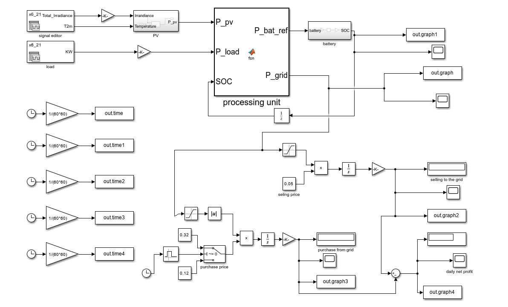
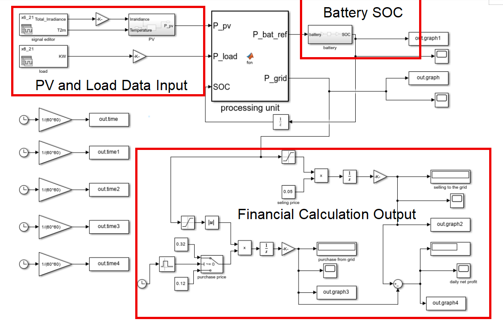

# Application, Design Considerations, and Feasibility Study of the Large-Scale Vanadium Batteries with a 100kW Photovoltaic System at Medway-UK

### Final Year Project | University of Greenwich (2025–2026)

## Project Overview

This project investigates the technical and economic feasibility of integrating a **100 kW photovoltaic (PV) system** with a **400 kWh Vanadium Redox Flow Battery (VRFB)** in Medway, United Kingdom.

A MATLAB/Simulink model was developed to analyse solar power generation, battery energy management, electricity grid interaction, and the financial performance of the integrated system.

## Project Objectives

- Develop a 24-hour PV-battery microgrid simulation.
- Analyse battery State of Charge (SOC) and energy management strategies.
- Investigate peak shaving using Time-of-Use electricity tariffs.
- Evaluate capital investment and the economic payback period.

## Technologies and Tools

- MATLAB
- Simulink
- Renewable Energy Systems
- Battery Energy Storage Systems
- Energy Management and Control
- Techno-Economic Analysis

## System Architecture and Simulation Model

The proposed PV–VRFB microgrid was modelled using MATLAB/Simulink to investigate power management, battery operation, grid interaction, and economic performance over a 24-hour simulation period.

The model consists of five main functional components:

### 1.PV and Load Data Input

Solar irradiance and electrical load profiles for **21 June 2023 in Medway, UK**, were imported into MATLAB/Simulink using Signal Editor blocks.
These inputs were used to generate the PV output power (`P_pv`) and represent electrical demand (`P_load`) for the 24-hour energy management simulation.

### 3. Processing Unit — Energy Management

The Processing Unit is implemented using a MATLAB Function block (`fcn`).

It receives PV power, electrical load demand, and battery State of Charge (SOC) as inputs. Based on these values, the controller calculates the battery power reference (`P_bat_ref`) and grid power (`P_grid`).

The implemented control logic prioritises solar energy utilisation and battery charging or discharging, subject to SOC operating limits of 20% and 80%.

### 4. Battery Storage and SOC Feedback

The battery subsystem receives the charging or discharging power reference from the Processing Unit.

Its SOC output is fed back to the controller through a Unit Delay block, allowing the controller to determine the appropriate operating mode based on the battery's previous SOC value.

### 5. Grid Interaction and Financial Analysis

A techno-economic feasibility analysis was conducted to evaluate the financial performance of the proposed 100 kW PV and 400 kWh VRFB system.

The analysis was based on a 24-hour MATLAB/Simulink simulation using solar irradiance and load inputs for 21 June 2023 in Medway, UK. A Time-of-Use electricity tariff model was adopted, with off-peak and peak import prices assumed to be £0.12/kWh and £0.32/kWh, respectively.

## Key Simulation Results

| Parameter | Result |
|---|---|
| Solar PV Capacity | 100 kW |
| VRFB Energy Capacity | 400 kWh |
| Estimated Capital Investment | £150,000 |
| Simulated Daily Net Profit | £47 |
| Estimated Annual Profit | £17,155 |
| Simple Payback Period | 8.7 years |

These results are based on the simulation assumptions and electricity tariffs adopted in the project. They do not represent verified real-world operational returns.

## Project Structure

The repository is intended to include the Simulink model, relevant MATLAB control logic, simulation results, supporting data, and technical documentation.

## Author

**Yutong Wu**

BEng (Hons) Electrical and Electronic Engineering Technology

University of Greenwich, United Kingdom

Academic Year: 2025–2026
