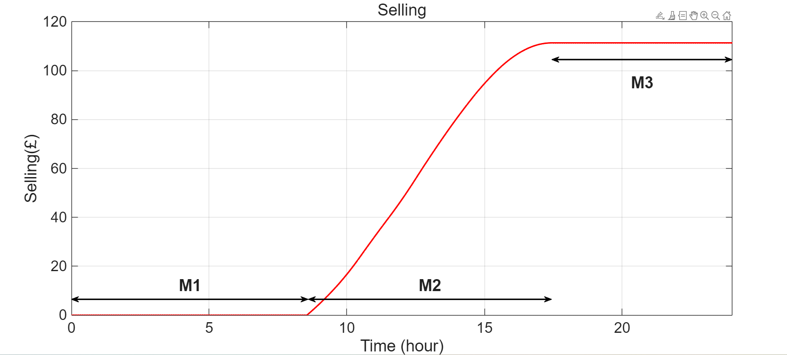
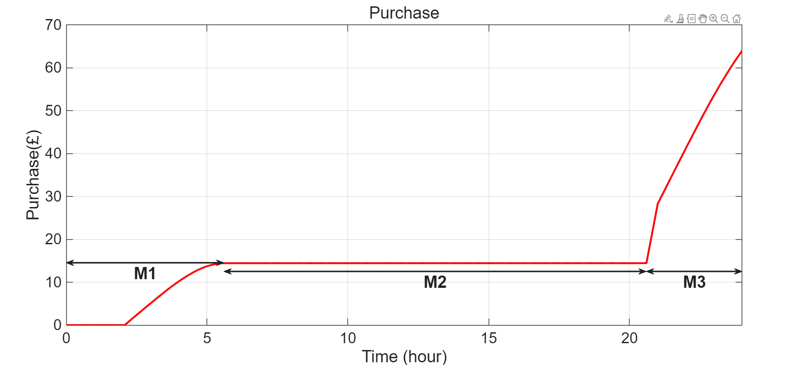

# Techno-Economic Analysis

## 1. Economic Calculation Module

The economic calculation module was implemented in MATLAB/Simulink to evaluate the financial performance of the PV–VRFB microgrid.

The module consists of three main calculation branches: electricity export revenue, electricity import cost, and daily net electricity cash flow.

### 1.1 Selling to the Grid

*Figure 1. Simulink electricity export revenue calculation module.*

The selling module calculates the cumulative revenue generated by exporting surplus electricity to the utility grid.

Positive grid power (`P_grid > 0`) represents electricity exported from the PV–VRFB system. The exported power is integrated over time to determine the total energy sold, which is then multiplied by the assumed export tariff.

The calculation can be expressed as:

**Export Revenue = Exported Energy × Selling Tariff**

### 1.2 Purchase from the Grid

*Figure 2. Simulink electricity import cost calculation module.*

The purchasing module calculates the cumulative cost of importing electricity when PV generation and battery storage cannot fully satisfy the load demand.

Negative grid power (`P_grid < 0`) represents electricity imported from the grid.

A Time-of-Use (ToU) pricing mechanism was implemented using Clock, Interval Test, and Switch blocks to distinguish between off-peak and peak electricity tariffs.

The assumed import tariffs are:

- Off-peak tariff: £0.12/kWh
- Peak tariff: £0.32/kWh
- Peak period: 17:00–21:00

The purchasing module integrates the imported power over time while applying the corresponding electricity tariff.

**Import Cost = Sum of (Imported Energy × Applicable Tariff)**

### 1.3 Daily Net Profit

*Figure 3. Simulink daily net electricity cash flow calculation module.*

The final calculation branch combines cumulative electricity export revenue and import expenditure to determine the net financial outcome over the 24-hour simulation.

**Daily Net Electricity Cash Flow = Export Revenue − Import Cost**

.png)

The reported simulation results were:

| Parameter | Simulated Result |
|---|---:|
| Electricity Export Revenue | £112 |
| Electricity Import Cost | £65 |
| Daily Net Electricity Cash Flow | £47 |

These values represent electricity trading performance under the assumed simulation conditions and exclude additional operational expenses.

## 2. Economic Feasibility and Payback Period

The estimated capital expenditure (CAPEX) for the proposed system was £150,000, including the 100 kW photovoltaic system, 400 kWh VRFB storage, and installation-related costs.

Assuming that the simulated daily net cash flow of £47 remains constant throughout the year:

**Annualised Cash Flow = £47 × 365 = £17,155**

**Simple Payback Period = £150,000 / £17,155 ≈ 8.7 years**

## 3. Assumptions and Limitations

The analysis is based on a selected 24-hour simulation scenario for 21 June 2023 in Medway, UK.

The simple payback estimate assumes constant daily financial performance throughout the year. Seasonal solar variability, changes in tariffs, operating and maintenance expenses, and discounted cash flow effects were not explicitly incorporated.

Therefore, the estimated 8.7-year payback period represents a simplified feasibility assessment rather than a verified long-term financial return.
